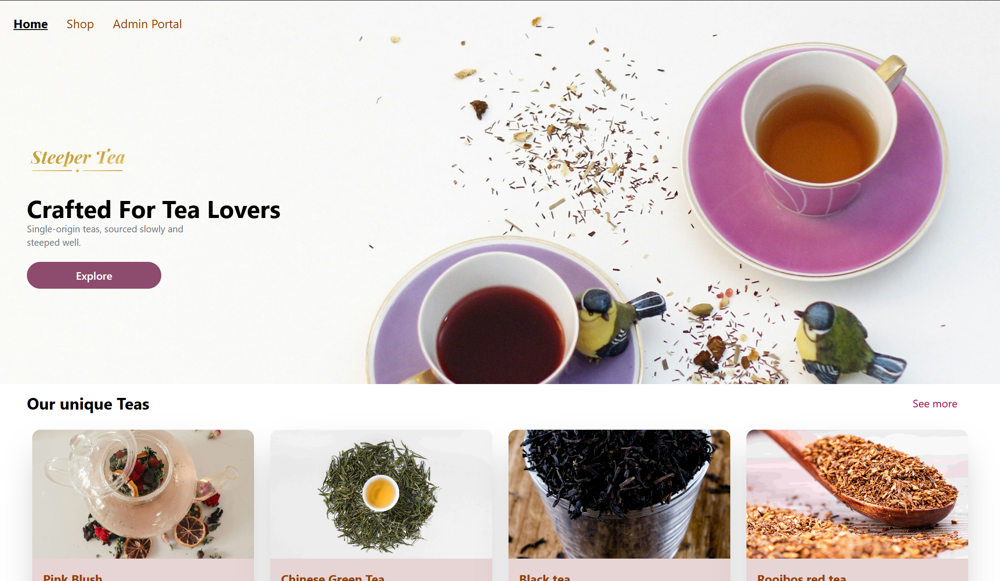

# Steepers Tea

Steepers Tea is a React storefront for browsing, searching, and managing a curated tea catalog. It includes a welcoming landing page, a filterable shop, and an admin portal for adding and removing teas.



## Features

- Browse featured teas on the home page
- Search teas by name or origin
- Filter teas by category
- View tea descriptions, origins, categories, photos, and prices in Kenyan shillings
- Add teas to the catalog from the admin portal
- Remove teas with a confirmation prompt
- Upload a local image for a new tea (limited to 500 KB)

## Tech Stack

- React 19
- Vite 8
- React Router 7
- Tailwind CSS 4
- JSON Server 0.17
- Express 5
- ESLint

## Tea Categories

- Special
- Black
- Green
- Herbal
- Other

## Getting Started

### Prerequisites

- Node.js 18 or newer
- npm

### 1. Install dependencies

```bash
npm install
```

### 2. Start the API

In one terminal, start JSON Server:

```bash
node server.cjs
```

The API will be available at `http://localhost:3001`. Tea resources are available at:

```text
http://localhost:3001/teas
```

Development data is stored in [`db.json`](./db.json).

### 3. Start the React application

In a second terminal, start the Vite development server:

```bash
npm run dev
```

Open the local URL shown by Vite (usually `http://localhost:5173`).

## Available Routes

| Route | Description |
| --- | --- |
| `/` | Landing page and featured teas |
| `/shop` | Searchable, categorized tea shop |
| `/adminportal` | Add and remove tea catalog entries |

## Development Data Flow

During development, the application fetches tea data from `http://localhost:3001/teas`.

In production, the application uses [`public/teas.json`](./public/teas.json), which is served as `/teas.json`. This file contains the static catalog used by the deployed site.

The admin portal is configured for the local JSON Server API and requires `server.cjs` to be running.

## Tea Data Format

Each tea entry uses the following fields:

```json
{
  "name": "Black tea",
  "description": "A rich, full-bodied black tea.",
  "origin": "Kericho, Kenya",
  "category": "Black",
  "price": 450,
  "photo": "/images/Black-tea.jpg",
  "id": 3
}
```

Images stored in `public/images` should use paths beginning with `/images/`, for example `/images/Black-tea.jpg`.

## Scripts

| Command | Description |
| --- | --- |
| `npm run dev` | Start the Vite development server |
| `npm run build` | Create a production build |
| `npm run lint` | Run ESLint |
| `npm run preview` | Preview the production build locally |
| `node server.cjs` | Start the local JSON Server API |

## Build and Preview

Create and preview a production build:

```bash
npm run build
npm run preview
```

The generated static files are written to `dist/`.

## Project Structure

```text
steepers-tea/
├── public/
│   ├── images/       # Tea images
│   └── teas.json     # Production catalog
├── src/
│   ├── components/   # Shared UI components
│   ├── constants/    # Tea categories
│   ├── pages/        # Home, shop, and admin pages
│   ├── App.jsx       # Application routes
│   └── main.jsx      # React entry point
├── db.json           # JSON Server development data
├── server.cjs        # Local API server
└── vite.config.js    # Vite and Tailwind configuration
```
